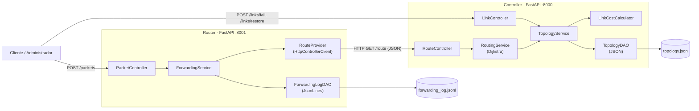
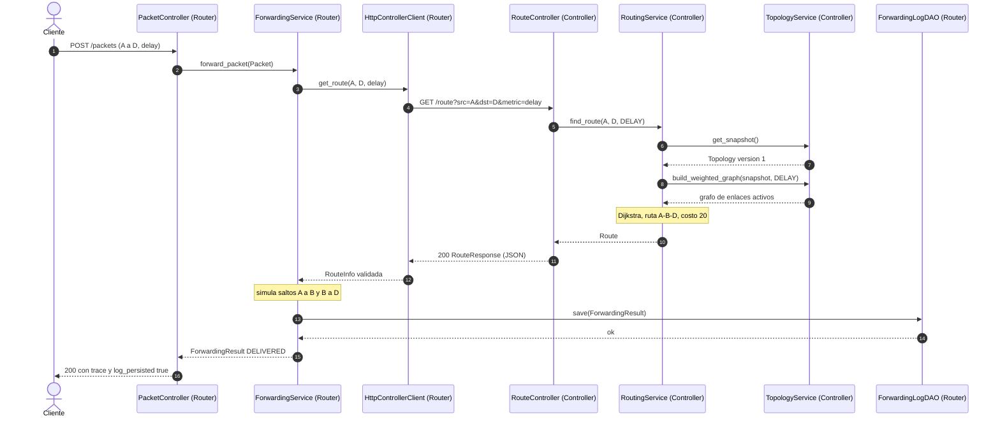

# Documento de Arquitectura y Requisitos del Sistema

*Documento de la Sesión 2 elaborado con la estructura de la plantilla "System Architecture and Requirements Document Template". Detalle completo: `specs/02-static-architecture.md`, `03-dynamic-architecture.md` y `04-api-contract.md` (v1.1).*

| Campo | Descripción |
|---|---|
| Curso | Informática para Telecomunicaciones |
| Programa | Ingeniería de Telecomunicaciones |
| Proyecto | Controlador y Enrutador SDN (simulación a nivel de aplicación) |
| Nombre del equipo | _completar_ |
| Integrantes | Estudiante A (Controller): _completar_ · Estudiante B (Router): _completar_ |
| Profesor | _completar_ |
| Fecha | 2026-10-26 |
| Versión | 1.0 |

## 1. Introducción

### 1.1 Propósito del documento

Este documento describe los requisitos, la arquitectura, los componentes, los mecanismos de comunicación, las estructuras de datos y la estrategia de pruebas del sistema SDN desarrollado en el curso de Informática para Telecomunicaciones, tal como quedó implementado en la Sesión 2.

### 1.2 Contexto del proyecto

El proyecto es un sistema de enrutamiento centralizado en Python, inspirado en SDN (*Software-Defined Networking*). Tiene dos aplicaciones independientes. El **Controller** mantiene la vista global de la red y calcula las rutas. El **Router** recibe paquetes simulados, le pide la ruta al Controller y simula el reenvío. El Router nunca calcula caminos: así se separan el plano de control y el plano de datos.

### 1.3 Alcance del proyecto

| Incluido | No incluido |
|---|---|
| Aplicación Controller (FastAPI) | Routers físicos reales |
| Aplicación Router (FastAPI) | Reenvío real de paquetes por la red |
| Comunicación HTTP REST con mensajes JSON | Enrutamiento a escala de Internet |
| Topología cargada desde un archivo JSON | Implementación completa de OpenFlow, OSPF, BGP o RIP |
| Cálculo de rutas con Dijkstra y tres métricas | Autenticación, alta disponibilidad, varios workers |
| Fallo y restablecimiento de enlaces | Persistencia del estado de fallos entre reinicios |
| Simulación del reenvío salto a salto y registro en un log | Controlador SDN para producción |

## 2. Objetivos

**Objetivo general:** desarrollar en Python un sistema de enrutamiento centralizado en el que un Router obtiene del Controller, por HTTP/JSON, las rutas calculadas con Dijkstra sobre la topología global y simula el reenvío de paquetes, reaccionando a fallos y restablecimientos de enlaces.

1. Diseñar la arquitectura de un sistema con un Controller y un Router separados, organizados con MVC y DAO.
2. Implementar la comunicación entre el Router y el Controller con HTTP REST y mensajes JSON.
3. Implementar Dijkstra con tres métricas de costo (retardo, inverso del ancho de banda y pérdida) y la actualización de rutas ante fallos de enlace.
4. Validar el sistema con pruebas funcionales, de arquitectura y no funcionales automatizadas.

## 3. Visión general del sistema

El sistema sigue una arquitectura centralizada. El Router no calcula rutas: por cada paquete le consulta al Controller, que tiene la vista global de la red y decide el camino.

| Componente | Descripción |
|---|---|
| Aplicación Controller | Entidad central que administra la topología, calcula las rutas y las expone por REST |
| Aplicación Router | Recibe paquetes, pide la ruta al Controller, simula el reenvío y registra el resultado |
| Módulo de comunicación | `HttpControllerClient` (Router) y los controladores HTTP de FastAPI (ambas apps) |
| Gestor de topología | `TopologyService` + `TopologyDAO`: carga, valida y actualiza la topología |
| Módulo del algoritmo de enrutamiento | `RoutingService` (Dijkstra) + `LinkCostCalculator` (métricas) |
| Módulo de reenvío | `ForwardingService`: simulación salto a salto |
| Módulo de registro (log) | `ForwardingLogDAO`: guarda cada resultado en `forwarding_log.jsonl` |
| Interfaz | API REST (con documentación automática en `/docs`) y línea de comandos para arrancar las apps y la demo |

## 4. Requisitos funcionales

| ID | Requisito | Descripción | Prioridad |
|---|---|---|---|
| FR-01 | Carga de topología | El Controller carga la topología desde JSON mediante `TopologyDAO`. | Alta |
| FR-02 | Topologías arbitrarias | Cualquier topología válida se representa con NetworkX sin cambiar código. | Alta |
| FR-03 | Cálculo de rutas | El Controller calcula rutas de costo mínimo con Dijkstra. | Alta |
| FR-04 | Costos de enlace | Métricas `delay` (d), `bandwidth` (1/b) y `loss` (−ln(1−p)). | Alta |
| FR-05 | API REST | El Controller expone `/route`, `/topology` y `/health`. | Alta |
| FR-06 | Fallo y restablecimiento | El administrador falla y restablece enlaces; las rutas se recalculan. | Alta |
| FR-07 | Rutas por HTTP | El Router pide cada ruta al Controller con `GET /route`. | Alta |
| FR-08 | Simulación del reenvío | El Router simula el reenvío salto a salto y devuelve el `trace`. | Alta |
| FR-09 | Manejo de errores | Errores controlados con un formato JSON único; las apps no se caen. | Alta |
| FR-10 | Registro de eventos | Cada resultado de reenvío (`DELIVERED` o `UNREACHABLE`) se registra mediante `ForwardingLogDAO`. | Alta |

## 5. Requisitos no funcionales

| ID | Requisito | Descripción | Prioridad |
|---|---|---|---|
| NFR-01 | MVC | Ambas apps separan Modelo, Vista y Controlador. | Alta |
| NFR-02 | DAO | El acceso a archivos pasa solo por clases DAO. | Alta |
| NFR-03 | Separación de lógica | Dijkstra y el reenvío están fuera de los manejadores HTTP. | Alta |
| NFR-04 | Mensajes JSON | Toda la comunicación usa JSON según el contrato de API. | Alta |
| NFR-05 | Configurabilidad | Puertos, archivos y URL del Controller por variables de entorno. | Media |
| NFR-06 | Robustez | Los mensajes y situaciones inválidas no detienen las apps. | Media |
| NFR-07 | Mantenibilidad | Código orientado a objetos, con inyección de dependencias y documentado. | Media |
| NFR-08 | Trazabilidad | Cada requisito se vincula con tareas, componentes y pruebas. | Media |
| NFR-09 | Testabilidad | Los DAO se reemplazan por dobles de prueba. | Alta |
| NFR-10 | Rendimiento | p95 ≤ 200 ms en una red de 200 nodos y 1000 enlaces. | Baja |
| NFR-11 | Resiliencia | Si el Controller no responde, el Router contesta 503 rápido y sigue vivo. | Media |
| NFR-12 | Consistencia | La ruta y su versión de topología salen del mismo estado. | Media |

## 6. Arquitectura del sistema

### 6.1 Estilo arquitectónico

Se combinan tres estilos:
- **Arquitectura centralizada tipo SDN:** el Controller (plano de control) decide y el Router (plano de datos) ejecuta.
- **Cliente-servidor sobre HTTP REST:** el Router es cliente del Controller, y ambos son servidores para el usuario.
- **MVC + DAO dentro de cada aplicación:** controladores HTTP → servicios de dominio → interfaces DAO → archivos. Las dependencias se inyectan por el constructor desde `main.py`.

### 6.2 Diagrama de arquitectura



Los diagramas de clases completos de ambas aplicaciones están en `02-static-architecture.md` §2–3.

## 7. Descripción de componentes

| Componente | Responsabilidad principal | Entrada | Salida |
|---|---|---|---|
| Aplicación Controller | Administrar la topología global y decidir rutas | `GET /route`, `POST /links/fail`, `POST /links/restore`, `topology.json` | Rutas (JSON), estado de enlaces, mensajes de error |
| Aplicación Router | Simular el reenvío de paquetes | `POST /packets`, rutas del Controller | `ForwardingResult` con `trace`, línea en el log |
| `TopologyService` | Cargar, validar y actualizar la topología con instantáneas inmutables | `Topology` del DAO, fallos/restablecimientos | Instantánea vigente, grafo ponderado |
| `RoutingService` | Calcular la ruta de costo mínimo | Origen, destino, métrica | `Route` (camino, costos, versión) |
| `LinkCostCalculator` | Convertir los atributos del enlace en un costo ≥ 0 | Enlace (d, b, p) y métrica | Costo numérico |
| `ForwardingService` | Pedir la ruta, simular los saltos y registrar | `Packet` | `ForwardingResult` |
| `HttpControllerClient` | Consultar al Controller y validar su respuesta | Origen, destino, métrica | `RouteInfo` o un error de dominio |
| `TopologyDAO` / `ForwardingLogDAO` | Leer y escribir archivos | Ruta del archivo / resultado | `Topology` / línea JSON |

## 8. Diseño de la comunicación

| Campo | Descripción |
|---|---|
| Protocolo | HTTP/1.1 sobre TCP (REST) |
| Formato de datos | JSON |
| Codificación | UTF-8 |
| Modelo de comunicación | Cliente-servidor (petición-respuesta) |
| Servidor | Controller (y también el Router, frente al cliente) |
| Clientes | Router (`HttpControllerClient`), cliente y administrador |
| Timeout del Router hacia el Controller | `CONTROLLER_TIMEOUT_S` (2 s por defecto), sin reintentos |

| Mensaje (endpoint) | Emisor | Receptor | Propósito |
|---|---|---|---|
| `POST /packets` | Cliente | Router | Enviar un paquete simulado y obtener el `trace` |
| `GET /route?src=&dst=&metric=` | Router | Controller | Pedir la ruta de costo mínimo |
| `POST /links/fail` | Administrador | Controller | Fallar un enlace |
| `POST /links/restore` | Administrador | Controller | Restablecer un enlace |
| `GET /topology` | Cliente / administrador | Controller | Consultar la topología y el estado de los enlaces |
| `GET /health` | Cualquiera | Ambas apps | Verificar la disponibilidad |
| Respuesta de error (`{"error": …}`) | Controller / Router | Cliente | Informar un error con código, mensaje y detalles |

Códigos de error: 400 `INVALID_PARAMETER`, 404 `NODE_NOT_FOUND` / `ROUTE_NOT_FOUND` / `LINK_NOT_FOUND`, 409 `LINK_ALREADY_FAILED` / `LINK_ALREADY_ACTIVE`, 502 `CONTROLLER_BAD_RESPONSE`, 503 `TOPOLOGY_UNAVAILABLE` / `CONTROLLER_UNAVAILABLE` / `CONTROLLER_TIMEOUT`, 500 `INTERNAL_ERROR`.

## 9. Ejemplos de mensajes JSON

Paquete enviado al Router (`POST /packets`):

```json
{"packet_id": "pkt-001", "src": "A", "dst": "D", "metric": "delay", "payload": "hello"}
```

Ruta que devuelve el Controller (`GET /route?src=A&dst=D&metric=delay`):

```json
{"src": "A", "dst": "D", "metric": "delay", "path": ["A", "B", "D"], "hop_costs": [10.0, 10.0], "total_cost": 20.0, "topology_version": 1}
```

Fallo de enlace (`POST /links/fail`) y su respuesta:

```json
{"node_a": "B", "node_b": "D"}
{"link": {"node_a": "B", "node_b": "D", "status": "failed"}, "topology_version": 2}
```

Resultado del reenvío que devuelve el Router:

```json
{
  "packet_id": "pkt-001", "status": "DELIVERED", "src": "A", "dst": "D", "metric": "delay",
  "route": {"path": ["A", "B", "D"], "total_cost": 20.0, "topology_version": 1},
  "trace": [
    {"hop": 1, "from_node": "A", "to_node": "B", "status": "FORWARDED"},
    {"hop": 2, "from_node": "B", "to_node": "D", "status": "FORWARDED"}
  ],
  "reason": null, "log_persisted": true, "warnings": [], "timestamp": "2026-10-26T12:00:00Z"
}
```

Mensaje de error (nodo inexistente):

```json
{"error": {"code": "NODE_NOT_FOUND", "message": "Node 'Z' does not exist", "details": {"node": "Z"}}}
```

## 10. Modelo de datos

| Entidad | Campo | Tipo | Descripción |
|---|---|---|---|
| Link | node_a, node_b | String | Extremos del enlace (no dirigido) |
| Link | delay_ms | Float | Retardo en milisegundos (≥ 0) |
| Link | bandwidth_mbps | Float | Ancho de banda en Mbps (> 0) |
| Link | loss_prob | Float | Probabilidad de pérdida (0 ≤ p ≤ 1) |
| Link | status | `active` / `failed` | Estado del enlace |
| Topology | nodes, links | Lista | Nodos y enlaces de la red |
| Topology | version | Integer | Empieza en 1 y aumenta con cada fallo o restablecimiento |
| Route | path | Lista de String | Nodos del camino, de origen a destino |
| Route | hop_costs, total_cost | Float | Costo de cada salto y costo total |
| Route | topology_version | Integer | Versión de la topología con la que se calculó |
| Packet | packet_id, src, dst, metric, payload | String | Paquete simulado |
| HopRecord | hop, from_node, to_node, status | Integer / String | Un salto del `trace` |
| ForwardingResult | status | `DELIVERED` / `UNREACHABLE` | Resultado de la simulación |
| ForwardingResult | route, trace, reason, timestamp | — | Ruta usada, saltos, motivo y hora |
| ForwardingResult | log_persisted, warnings | Boolean / Lista | Si el registro quedó guardado y los avisos |

`Link` y `Topology` son **inmutables**: cada fallo o restablecimiento crea una topología nueva con `version + 1`.

## 11. Estructura del proyecto

```text
Sesion2/
├── controller/
│   ├── main.py                    # raíz de composición (crea DAO y servicios)
│   ├── config.py                  # variables de entorno
│   ├── controllers/               # route_, link_, topology_, health_controller
│   ├── schemas/                   # esquemas JSON (Vista)
│   ├── models/                    # Link, Topology, Route, LinkChange, Metric
│   ├── services/                  # routing_service, topology_service, link_cost_calculator
│   ├── dao/                       # topology_dao (interfaz), json_topology_dao
│   ├── exceptions.py              # errores de dominio + ErrorHandler
│   └── data/topology.json
├── router/
│   ├── main.py, config.py, exceptions.py
│   ├── controllers/               # packet_, health_controller
│   ├── schemas/, models/
│   ├── services/                  # forwarding_service
│   ├── clients/                   # route_provider (interfaz), http_controller_client
│   └── dao/                       # forwarding_log_dao (interfaz), jsonlines_forwarding_log_dao
├── tests/                         # controller/, router/, architecture/, integration/, performance/, fixtures/
├── docs/                          # 01-scrum-requirements, 02-test-plan, 03-system-architecture, architecture-review
├── scripts/demo.py
├── demo-evidence/
└── README.md
```

## 12. Descripción del algoritmo de enrutamiento

El sistema usa **Dijkstra** (`networkx.dijkstra_path`) para calcular el camino de costo mínimo entre dos nodos sobre la topología global que mantiene el Controller.

1. **Toma de la instantánea.** `RoutingService` obtiene una sola vez la topología vigente. Como es inmutable, la ruta y su `topology_version` siempre corresponden al mismo estado, aunque en ese momento alguien falle un enlace.
2. **Construcción del grafo ponderado.** Se crea un grafo no dirigido con todos los nodos y solo los enlaces **activos y utilizables**. Se excluyen los enlaces fallados y los que tienen p = 1. El peso de cada enlace depende de la métrica:
   - `delay`: costo = d (los retardos se suman a lo largo del camino);
   - `bandwidth`: costo = 1/b (es una heurística: favorece enlaces anchos, pero sumar 1/b no equivale a maximizar el ancho de banda del cuello de botella);
   - `loss`: costo = −ln(1−p). Sumar estos valores equivale a maximizar la probabilidad de que el paquete llegue, si las pérdidas son independientes.
3. **Dijkstra.** Todos los pesos son ≥ 0, que es la condición para que Dijkstra garantice el camino óptimo. Si no hay camino, se responde `ROUTE_NOT_FOUND`; si el nodo no existe, `NODE_NOT_FOUND`.
4. **Resultado.** Se devuelven el camino, el costo de cada salto, el costo total y la versión de la topología.

Ejemplo con la topología de referencia (A→D): con `delay` gana A–B–D (costo 20 contra 25); con `bandwidth` gana A–C–D (0,02 contra 0,20); con `loss` gana A–B–D (0,0201 contra 0,1026). Si falla B–D, con `delay` la ruta pasa a A–C–D con costo 25.

## 13. Diagrama de secuencia

Flujo principal: reenvío exitoso de un paquete. Las secuencias de fallo de enlace, Controller caído, respuesta inválida y concurrencia están en `03-dynamic-architecture.md`.



## 14. Estrategia de pruebas

| Área de prueba | Descripción | Casos |
|---|---|---|
| Algoritmo de enrutamiento | Dijkstra elige el camino correcto con cada métrica | TC-01, TC-02, TC-10 |
| Fallo y restablecimiento de enlaces | Las rutas cambian y la versión aumenta | TC-03, TC-04 |
| Comunicación Router–Controller | El Router obtiene la ruta por HTTP y valida la respuesta | TC-05, TC-25 |
| Simulación del reenvío y registro | `trace` correcto y persistencia de todos los resultados | TC-06, TC-09, TC-15, TC-24, TC-26 |
| Manejo de errores | Controller caído, nodo inexistente, destino inalcanzable, topología inválida | TC-07, TC-11, TC-17, TC-19 |
| Arquitectura MVC/DAO | AST, sustitución de interfaces, delegación con espías y revisión manual | TC-08, TC-12, TC-13, TC-14, TC-21, TC-22, TC-23, RA-01…RA-10 |
| Integración | Dos procesos reales comunicándose por HTTP | TC-16 |
| No funcionales | Concurrencia y rendimiento | TC-20, TC-18 |

Resultado: 26 de 26 casos (76 pruebas automáticas) aprobados. El detalle está en `docs/02-test-plan.md`.

## 15. Conclusiones

**¿Se implementó el sistema con éxito?** Sí. Las dos aplicaciones funcionan como procesos independientes, se comunican por HTTP/JSON y cumplen los 10 requisitos funcionales y los 12 no funcionales, con 76 de 76 pruebas aprobadas y la demo en vivo ejecutada (`demo-evidence/demo-log.txt`).

**¿El Controller calcula correctamente las rutas?** Sí. Dijkstra elige el camino óptimo con las tres métricas (TC-01, TC-02), recalcula al fallar y restablecer enlaces (TC-03, TC-04) y siempre devuelve una ruta coherente con su versión de topología, incluso con consultas y cambios simultáneos (TC-20).

**¿El Router recibe y usa la información de enrutamiento?** Sí. Obtiene cada ruta con `GET /route`, la valida, simula el reenvío salto a salto y registra tanto los paquetes entregados como los inalcanzables. Si el Controller está caído responde 503 y sigue activo.

**Principales desafíos técnicos.**
- Mantener la separación MVC/DAO de verdad, no solo en las carpetas: se verificó con pruebas AST, servicios espía y sustitución de DAO.
- Garantizar que una ruta y su versión salgan del mismo estado bajo concurrencia, lo que se resolvió con instantáneas inmutables y un lock solo para las escrituras.
- Definir qué pasa cuando el log no se puede escribir. Se resolvió distinguiendo una simulación *completada* de una *auditable*, con `log_persisted`.
- Clasificar las respuestas inesperadas del Controller, para lo que se agregó el código 502.

**Mejoras futuras.**
- Persistir el estado de los enlaces entre reinicios.
- Admitir varios Routers y varios workers con un estado compartido.
- Agregar autenticación a los endpoints administrativos.
- Agregar una métrica de ancho de banda de cuello de botella (*widest path*) en lugar de la heurística 1/b.
- Hacer que el Router guarde en caché las rutas por versión de topología.
- Agregar una interfaz de línea de comandos para consultar la topología y el log.
