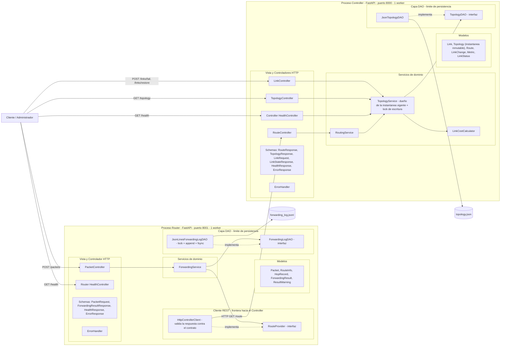
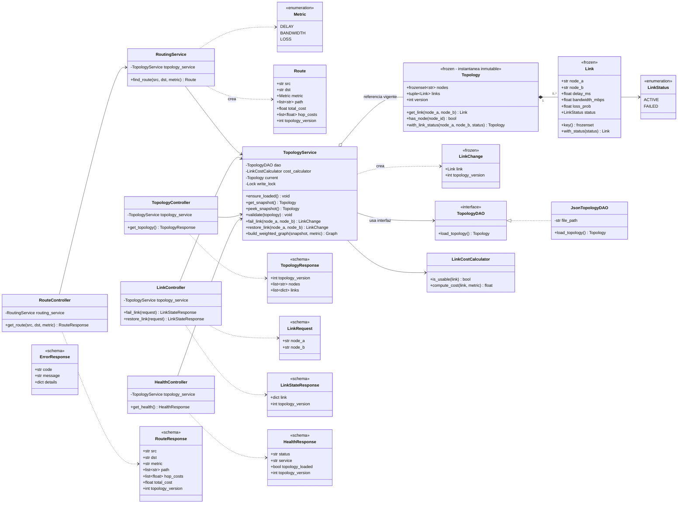
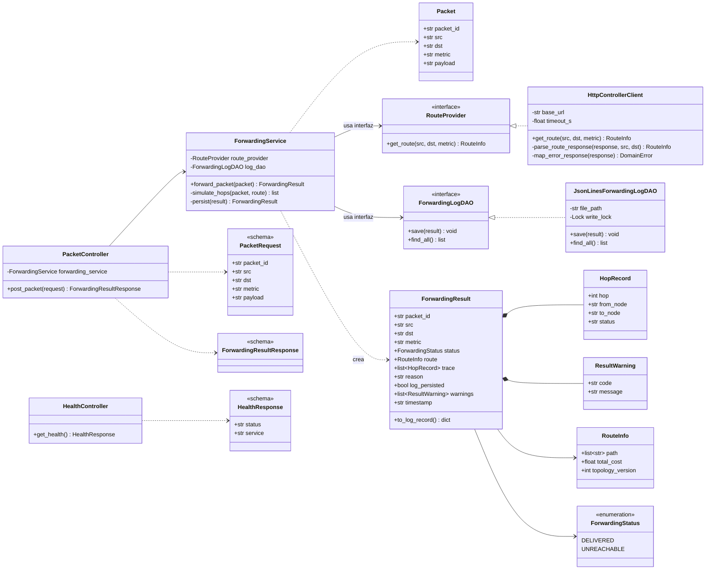
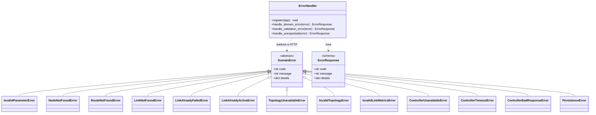

# 02 — Arquitectura Estática

Versión 1.1 (2026-10-26). Cambios respecto a 1.0 registrados en `01-requirements.md` §9 (CH-02, CH-03, CH-06, CH-09).

## 1. Diagrama de componentes



**Lectura del diagrama**
- La única conexión entre procesos es **HTTP/JSON** (`HttpControllerClient` → `RouteController`).
- Los accesos a archivos solo ocurren dentro de las clases DAO concretas.
- Los controladores HTTP solo conocen servicios y esquemas; los servicios solo conocen **interfaces** DAO.
- El estado mutable del Controller vive **solo** en `TopologyService` (referencia a la instantánea vigente); el estado mutable del Router vive **solo** en el archivo de log, al que se accede a través de `JsonLinesForwardingLogDAO` (ver §7.1).

## 2. Diagrama de clases — Controller



**Notas del diagrama (concurrencia, SPDR-02).**
- `Link`, `Topology` y `LinkChange` son *dataclasses* inmutables (`frozen=True`); `with_status` y `with_link_status` **devuelven objetos nuevos** y nunca modifican el original. `with_link_status` devuelve la nueva instantánea con `version + 1`.
- `get_snapshot()` llama a `ensure_loaded()` si no hay topología y devuelve la referencia vigente; si no se puede cargar, lanza `TopologyUnavailableError`.
- `peek_snapshot()` devuelve la referencia vigente **o `None`**, sin intentar cargar (lo usa `HealthController`, para que `/health` nunca dispare una carga).
- `build_weighted_graph(snapshot, metric)` es una función **pura** de la instantánea recibida: no lee `current`, así que el grafo siempre corresponde a la versión que se le pasó.
- Se eliminan `is_loaded()`, `has_node()` y `get_version()` de la versión 1.0: leían `current` por separado y dos lecturas consecutivas podían ver estados distintos. Ahora quien necesita esos datos los toma de **una** instantánea.

## 3. Diagrama de clases — Router



**Contratos de los métodos del Router (SPDR-01 y SPDR-03).**
- `ForwardingService.forward_packet(packet)`: (1) pide la ruta con `route_provider.get_route`; (2) si recibe `RouteInfo`, simula los saltos y arma un resultado `DELIVERED`; si recibe `RouteNotFoundError`, arma un resultado `UNREACHABLE` con `reason = "ROUTE_NOT_FOUND"`; cualquier otra excepción del proveedor **se propaga** sin crear resultado; (3) en **ambos** casos llama a `persist(result)` exactamente una vez; (4) devuelve el resultado.
- `ForwardingService.persist(result)`: llama a `log_dao.save(result)`. Si termina sin excepción → `log_persisted = true`. Si lanza **cualquier** excepción (normalmente `PersistenceError`) → `log_persisted = false`, agrega `ResultWarning("PERSISTENCE_ERROR", ...)` y registra el detalle en el log de la aplicación. Nunca reintenta y nunca relanza (fila D2/D4 de `01` §7.2).
- `ForwardingLogDAO.save(result)`: guarda `result.to_log_record()` (todos los campos **excepto** `log_persisted` y `warnings`). Solo puede lanzar `PersistenceError`; envuelve en ella `OSError`, `TypeError`/`ValueError` de serialización y cualquier otra falla. Implementación concreta: serializa primero en memoria; toma `write_lock`; si el archivo no termina en `\n`, escribe `\n`; escribe la línea completa con **una** llamada a `write`; `flush()` + `os.fsync()`; suelta el lock (A-16).
- `ForwardingLogDAO.find_all()`: devuelve los registros válidos y **omite** las líneas que no son JSON válido (fragmentos de escrituras parciales), registrando cuántas omitió; nunca falla por un fragmento.
- `HttpControllerClient.get_route`: hace `GET /route`; clasifica la respuesta con la tabla de `04` §3 (regla 4). `parse_route_response` valida el esquema `RouteResponse` y la coherencia de la ruta (A-15) **sin** calcular costos ni caminos.

## 3.1 Manejo de errores (ambas apps)

Cada app tiene su `exceptions.py` con las excepciones de dominio y el `ErrorHandler` que las traduce a HTTP (regla R6). Las excepciones **no** llevan lógica HTTP; el único que conoce los códigos de estado es el `ErrorHandler`.



| Excepción | HTTP que asigna el `ErrorHandler` | Notas |
|---|---|---|
| `InvalidParameterError` | 400 | También `RequestValidationError` de FastAPI → 400 |
| `NodeNotFoundError`, `RouteNotFoundError`, `LinkNotFoundError` | 404 | En el Router, `RouteNotFoundError` **no** llega al `ErrorHandler`: `ForwardingService` la convierte en `UNREACHABLE` |
| `LinkAlreadyFailedError`, `LinkAlreadyActiveError` | 409 | — |
| `ControllerBadResponseError` | 502 | Nueva en v1.1 (A-15) |
| `TopologyUnavailableError`, `ControllerUnavailableError`, `ControllerTimeoutError` | 503 | — |
| `InvalidTopologyError`, `InvalidLinkMetricsError` | — (interno) | Nunca salen de `TopologyService`: dejan la topología sin cargar |
| `PersistenceError` | — (interno) | Nunca sale de `ForwardingService`: se convierte en aviso |
| Cualquier otra excepción | 500 `INTERNAL_ERROR` | `handle_unexpected` |

## 4. Responsabilidades de las clases

### Controller
| Clase | Capa | Responsabilidad |
|---|---|---|
| `Link`/`Topology`/`LinkChange`/`Route` | Modelo | Objetos de dominio **inmutables** (salvo `Route`, que es un valor de salida) sin dependencias de HTTP ni de almacenamiento. `Topology` es la instantánea completa de la red con su `version`. |
| `RouteResponse`, `TopologyResponse`, `LinkRequest`, `LinkStateResponse`, `HealthResponse`, `ErrorResponse` | Vista | Esquemas Pydantic de entrada/salida (contrato JSON). |
| `RouteController`, `LinkController`, `TopologyController`, `HealthController` | Controlador | Traducen HTTP ⇄ servicios; **sin** lógica de enrutamiento ni acceso a datos. |
| `RoutingService` | Servicio | Toma **una** instantánea con `get_snapshot()`, valida que existan los nodos en ella, construye el grafo ponderado de esa instantánea, ejecuta Dijkstra y produce `Route` con `topology_version = snapshot.version`. Lanza `NodeNotFoundError` / `RouteNotFoundError`. No guarda estado. |
| `TopologyService` | Servicio | Único dueño del estado mutable: la referencia a la instantánea vigente. Carga bajo demanda (`ensure_loaded`), valida la topología, aplica fallos/restablecimientos creando instantáneas nuevas bajo `write_lock`, y construye grafos ponderados a partir de una instantánea dada. |
| `LinkCostCalculator` | Servicio | Convierte atributos del enlace en costo ≥ 0 según la métrica; decide si el enlace es utilizable. Sin estado. |
| `TopologyDAO` / `JsonTopologyDAO` | DAO | Leer y parsear el JSON; no valida semántica. Devuelve una `Topology` con `version = 1`. |
| `ErrorHandler` | Controlador (transversal) | Vive en `exceptions.py`. Traduce `DomainError` al código HTTP y al formato único de error, convierte `RequestValidationError` (422 de FastAPI) en 400 `INVALID_PARAMETER` y captura lo imprevisto como 500 `INTERNAL_ERROR`. Sin lógica de negocio. |

### Router
| Clase | Capa | Responsabilidad |
|---|---|---|
| `Packet`, `RouteInfo`, `HopRecord`, `ResultWarning`, `ForwardingResult` | Modelo | Objetos de dominio del plano de datos. `ForwardingResult.to_log_record()` define qué se persiste. |
| `PacketRequest`, `ForwardingResultResponse`, `HealthResponse`, `ErrorResponse` | Vista | Esquemas JSON de entrada/salida. |
| `PacketController`, `HealthController` | Controlador | Reciben HTTP, delegan en `ForwardingService`. |
| `ForwardingService` | Servicio | Pide la ruta vía `RouteProvider`, simula el reenvío salto a salto, arma el resultado (`DELIVERED` o `UNREACHABLE`), lo guarda **siempre** con el DAO y convierte cualquier fallo de persistencia en `log_persisted: false` + aviso. No guarda estado entre peticiones. |
| `RouteProvider` / `HttpControllerClient` | Cliente REST | Interfaz y adaptador HTTP hacia `GET /route`; valida la respuesta contra el contrato y traduce fallos de red, timeouts y respuestas inválidas en `ControllerUnavailableError` / `ControllerTimeoutError` / `ControllerBadResponseError`. |
| `ForwardingLogDAO` / `JsonLinesForwardingLogDAO` | DAO | Guardar y recuperar resultados de reenvío con escrituras serializadas, completas y durables (A-16). |
| `ErrorHandler` | Controlador (transversal) | Vive en `exceptions.py`. Traduce `DomainError` al código HTTP y al formato único de error, convierte `RequestValidationError` (422 de FastAPI) en 400 `INVALID_PARAMETER` y captura lo imprevisto como 500 `INTERNAL_ERROR`. Sin lógica de negocio. |

## 5. Mapeo MVC por aplicación

| Capa MVC | Controller | Router |
|---|---|---|
| **Modelo** | `models/` (Link, Topology, LinkChange, Route, Metric, LinkStatus) | `models/` (Packet, RouteInfo, HopRecord, ResultWarning, ForwardingResult) |
| **Vista** | `schemas/` | `schemas/` |
| **Controlador** | `controllers/` | `controllers/` |
| **Servicios de dominio** | `services/` (RoutingService, TopologyService, LinkCostCalculator) | `services/` (ForwardingService) |
| **DAO** | `dao/` (TopologyDAO, JsonTopologyDAO) | `dao/` (ForwardingLogDAO, JsonLinesForwardingLogDAO) |
| **Cliente externo** | — | `clients/` (RouteProvider, HttpControllerClient) |

## 6. Inyección de dependencias

La **raíz de composición** (`main.py` de cada app) es el único lugar que conoce las clases concretas:

| App | Ensamblado |
|---|---|
| Controller | `JsonTopologyDAO(TOPOLOGY_FILE)` → `TopologyService(dao, LinkCostCalculator())` → `RoutingService(topology_service)` → controladores |
| Router | `HttpControllerClient(CONTROLLER_URL, CONTROLLER_TIMEOUT_S)` y `JsonLinesForwardingLogDAO(FORWARDING_LOG_FILE)` → `ForwardingService(route_provider, log_dao)` → `PacketController` |

**Carga de la topología (decisión A-13).** `main.py` llama a `TopologyService.ensure_loaded()` al arrancar. Si falla (archivo inexistente, JSON corrupto o topología inválida), el proceso sigue vivo en estado `degraded` y cada petición posterior que necesite la topología vuelve a intentarlo a través de `get_snapshot()`. Por eso las secuencias muestran la carga como `opt`: solo ocurre si todavía no hay topología cargada.

- Se inyecta por **constructor**; los controladores reciben servicios mediante `Depends` de FastAPI.
- `main.py` crea **una sola** instancia de cada servicio por proceso (la que comparten todas las peticiones) y la app se ejecuta con **un worker** (A-14).
- En pruebas se inyecta un `FakeTopologyDAO` / `FakeRouteProvider` / `FakeForwardingLogDAO` **sin tocar** `RoutingService` ni `ForwardingService` (NFR-07, NFR-09; TC-08, TC-09, TC-21, TC-22), y los controladores se prueban con servicios espía mediante `app.dependency_overrides` (TC-23).

## 7. Reglas de diseño (verificables)

| Regla | Verificación |
|---|---|
| R1: `controllers/` no importa `networkx`, `heapq`, `json`, `pathlib` ni usa `open()`. | TC-12, RA-02 |
| R2: `services/` no usa `open()`, `json.load`, `pathlib` ni importa implementaciones DAO concretas. | TC-13, RA-03 |
| R3: `router/` no importa `networkx` ni implementa Dijkstra. | TC-14, RA-10 |
| R4: Toda dependencia entre servicio y almacenamiento pasa por una interfaz (`TopologyDAO`, `ForwardingLogDAO`, `RouteProvider`). | RA-04 + TC-08, TC-09, TC-21, TC-22 |
| R5: Solo `main.py` instancia clases concretas de DAO y cliente. | RA-05 |
| R6: Los errores de dominio son excepciones propias traducidas a HTTP en un manejador central, no en los servicios. | TC-11, TC-23, RA-06 |
| R7: El estado mutable del Controller es **solo** la referencia `TopologyService.current`. Se reemplaza únicamente dentro de `write_lock` y siempre por una instantánea nueva e inmutable; ninguna instantánea publicada se modifica. | TC-20, RA-07 |
| R8: `RoutingService.find_route` llama a `get_snapshot()` **una sola vez** por consulta y no vuelve a leer el estado del servicio; `topology_version` de la `Route` se toma de esa instantánea. `GET /topology` también se arma desde una sola instantánea. | TC-20, RA-07 |
| R9: `ForwardingService` llama a `save()` en **cada** rama que produce `ForwardingResult` y en **ninguna** rama de error. | TC-09, TC-24, RA-08 |
| R10: `JsonLinesForwardingLogDAO.save` serializa en memoria, escribe la línea completa con una sola llamada bajo `write_lock` y hace `fsync`; solo lanza `PersistenceError`. | TC-26, RA-08 |
| R11: `HttpControllerClient` clasifica **todas** las respuestas según `04` §3; nunca devuelve un `RouteInfo` sin validar. | TC-25, RA-09 |

## 7.1 Modelo de concurrencia y consistencia *(SPDR-02)*

**Por qué hace falta.** FastAPI atiende los endpoints síncronos (`def`) en un *pool* de hilos, así que una consulta `GET /route` y un `POST /links/fail` pueden ejecutarse al mismo tiempo sobre el mismo `TopologyService`.

**Mecanismo elegido: instantáneas inmutables con intercambio atómico (copy-on-write).**

| Operación | Qué hace | ¿Toma el lock? |
|---|---|---|
| `ensure_loaded()` | Si `current` es `None`: toma `write_lock`, vuelve a comprobar (*double-checked*), carga con el DAO, valida y publica la instantánea versión 1. Si falla, `current` sigue en `None` (estado `degraded`). | Sí (solo si no hay topología) |
| `fail_link(a, b)` / `restore_link(a, b)` | Dentro de `write_lock`: lee `current`, verifica que el enlace existe y que la transición es válida (404/409 si no), crea `new = current.with_link_status(a, b, estado)` (con `version + 1`), publica `current = new` y devuelve `LinkChange(link, new.version)`. | Sí |
| `get_snapshot()` | Llama a `ensure_loaded()` si hace falta y devuelve la referencia `current` (lectura de una referencia, tomada dentro de `write_lock` por claridad; es O(1)). | Brevemente |
| `RoutingService.find_route` | `snap = get_snapshot()` → valida nodos en `snap` → `build_weighted_graph(snap, metric)` → Dijkstra → `Route(..., topology_version = snap.version)`. | **No** durante Dijkstra |

**Garantías que ofrece el Controller.**

| ID | Garantía |
|---|---|
| G1 | **Coherencia ruta-versión:** `path`, `hop_costs`, `total_cost` y `topology_version` de una respuesta provienen exactamente de la misma instantánea, y la ruta es óptima para esa instantánea. |
| G2 | **Sin estados parciales:** ninguna consulta observa una topología "a medio cambiar", porque las instantáneas publicadas nunca se modifican. |
| G3 | **Sin actualizaciones perdidas:** las escrituras están serializadas; cada escritura exitosa incrementa la versión exactamente en 1 y las versiones no se repiten. Dos `fail` simultáneos sobre el mismo enlace producen un 200 y un 409. |
| G4 | **Orden en tiempo real:** una consulta que **empieza** después de que un cliente recibió el 200 de un cambio ve esa versión o una posterior. Una consulta **concurrente** con un cambio puede ver la versión anterior o la nueva, nunca una mezcla. |
| G5 | **Respuestas de cambio exactas:** la `topology_version` de `POST /links/fail|restore` es la de la instantánea que esa operación creó. `GET /topology` devuelve una instantánea completa. |

**Alcance de la garantía.** Es válida dentro de **un** proceso Controller con **un** worker. La ruta que recibe el Router puede quedar desactualizada si la topología cambia después de la consulta; eso está aceptado (A-12) y es visible porque el resultado lleva la `topology_version` con la que se decidió.

**Alternativa descartada.** Serializar todas las peticiones con un lock global (incluido Dijkstra) también garantizaría G1–G5, pero bloquearía los fallos/restablecimientos mientras se calcula cualquier ruta y haría que una consulta lenta (topología grande, NFR-10) retrasara a todas las demás. Con instantáneas, las lecturas no bloquean a nadie y el lock solo protege operaciones O(número de enlaces).

**Router.** `ForwardingService` y `HttpControllerClient` no tienen estado mutable compartido. El único recurso compartido es el archivo de log, protegido por `JsonLinesForwardingLogDAO.write_lock`, de modo que dos paquetes simultáneos producen dos líneas completas y nunca líneas intercaladas.

## 8. Estructura de directorios propuesta

```text
sdn-workshop/
├── specs/                      # 01..06 (+ README de la línea base)
├── controller/
│   ├── main.py                 # raíz de composición
│   ├── config.py
│   ├── controllers/            # route_, link_, topology_, health_controller
│   ├── schemas/
│   ├── models/
│   ├── services/               # routing_service, topology_service, link_cost_calculator
│   ├── dao/                    # topology_dao (interfaz), json_topology_dao
│   ├── exceptions.py           # errores de dominio + manejador HTTP
│   └── data/topology.json
├── router/
│   ├── main.py
│   ├── config.py
│   ├── controllers/            # packet_, health_controller
│   ├── schemas/
│   ├── models/
│   ├── services/               # forwarding_service
│   ├── clients/                # route_provider (interfaz), http_controller_client
│   ├── dao/                    # forwarding_log_dao (interfaz), jsonlines_forwarding_log_dao
│   ├── exceptions.py
│   └── data/
├── tests/
│   ├── controller/  router/  architecture/  integration/  performance/
│   ├── fixtures/               # topology.json, large_topology_200n_1000l.json
│   ├── test-results.txt
│   └── perf-environment.txt    # entorno de ejecución de TC-18
├── docs/architecture-review.md # resultado de la revisión RA-01…RA-10
├── prompts-session1.md
├── prompts-session2.md
├── demo-evidence/
└── README.md
```

## 9. Trazabilidad requisito → componente

| Requisito | Componentes principales |
|---|---|
| FR-01 | `TopologyDAO`, `JsonTopologyDAO`, `TopologyService.ensure_loaded` |
| FR-02 | `TopologyService.validate`, `build_weighted_graph`, `Topology`, `Link` |
| FR-03 | `RoutingService`, `Route`, `TopologyService.get_snapshot` |
| FR-04 | `LinkCostCalculator`, `Metric` |
| FR-05 | `RouteController`, `TopologyController`, `HealthController`, esquemas |
| FR-06 | `LinkController`, `TopologyService.fail_link/restore_link`, `LinkChange` |
| FR-07 | `RouteProvider`, `HttpControllerClient` (incluida la validación de respuesta) |
| FR-08 | `PacketController`, `ForwardingService`, `HopRecord`, `ForwardingResult` |
| FR-09 | `exceptions.py` (ambas apps), `ErrorHandler`, `HttpControllerClient.map_error_response` |
| FR-10 | `ForwardingLogDAO`, `JsonLinesForwardingLogDAO`, `ForwardingService.persist`, `ResultWarning` |
| NFR-12 | `TopologyService` (`current`, `write_lock`), `Topology` inmutable, `RoutingService` |
