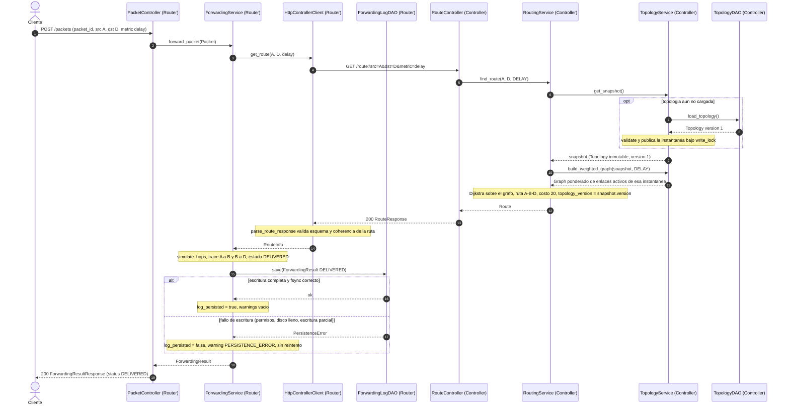
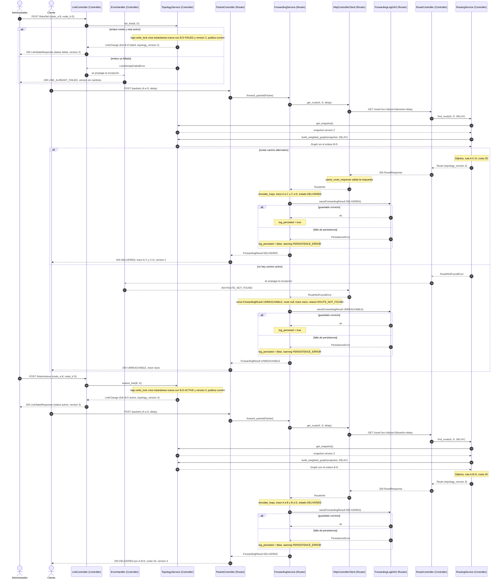
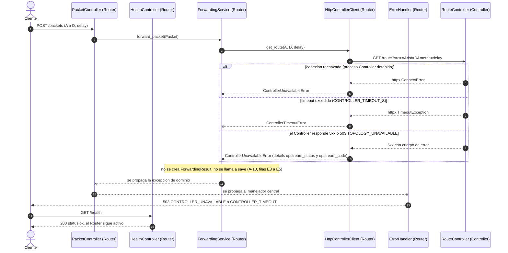
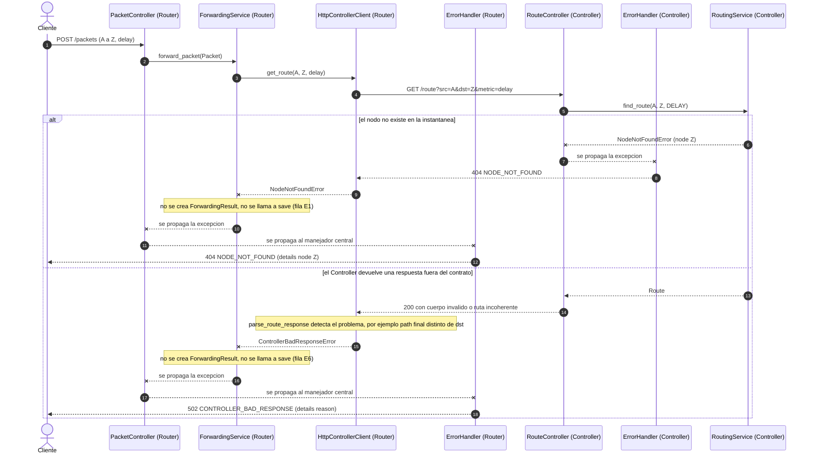
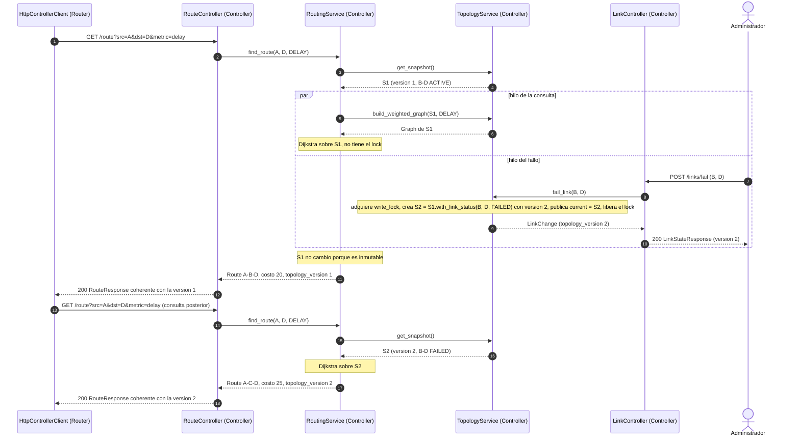

# 03 — Arquitectura Dinámica

Versión 1.1 (2026-10-26). Cambios respecto a 1.0 registrados en `01-requirements.md` §9 (CH-01, CH-02, CH-03, CH-04).

Topología de referencia usada en los ejemplos: la de `06-test-specification.md` (nodos A–F; A→D por `delay` = `[A,B,D]`, costo 20).

**Convenciones de los diagramas (SPDR-04).**
- Todo participante es una clase de `02-static-architecture.md` y se nombra `Clase (App)`, por ejemplo `RouteController (Controller)`. Solo los actores externos (Cliente, Administrador) no son clases.
- `->>` es una llamada o petición; `-->>` es un retorno normal; `--x` es una excepción lanzada o un fallo de red.
- Los errores siempre se propagan hasta el `ErrorHandler (App)` correspondiente, que es el único que produce la respuesta HTTP de error.
- Las llamadas a `ForwardingLogDAO.save()` se muestran siempre con sus dos salidas: éxito o `PersistenceError`.

| Secuencia | Escenario | Exigida por el enunciado |
|---|---|---|
| 1 | Reenvío exitoso | Sí |
| 2 | Fallo y recuperación de enlace (incluye camino alternativo y destino inalcanzable) | Sí |
| 3 | Controller no disponible (conexión rechazada, timeout, 5xx) | Sí |
| 4 | Nodo inexistente y respuesta inválida del Controller | Complementaria (SPDR-03) |
| 5 | Consulta de ruta concurrente con un fallo de enlace | Complementaria (SPDR-02) |

---

## Secuencia 1 — Reenvío exitoso de un paquete

| # | Mensaje | Clase / método | Contrato |
|---|---|---|---|
| 1 | Paquete entra al Router | `PacketController.post_packet` | `POST /packets` |
| 2 | Se delega al servicio | `ForwardingService.forward_packet` | — |
| 3–4 | Se pide la ruta (el Router **no** calcula) | `HttpControllerClient.get_route` → `RouteController.get_route` | `GET /route` |
| 5–9 | Se toma **una** instantánea; si no hay topología, carga diferida vía DAO | `RoutingService.find_route`, `TopologyService.get_snapshot`, `TopologyDAO.load_topology` | A-13, A-14 |
| 10–11 | Grafo ponderado de **esa** instantánea | `TopologyService.build_weighted_graph(snapshot, metric)` | R8 |
| 12–13 | Dijkstra → `Route` → respuesta JSON | `RoutingService`, `RouteController` | `200 RouteResponse` |
| 14 | Respuesta validada y entregada al servicio; luego simulación salto a salto (nota) | `HttpControllerClient.parse_route_response`, `ForwardingService.simulate_hops` | A-15 |
| 15–17 | Registro del resultado con sus dos salidas | `ForwardingService.persist` → `ForwardingLogDAO.save` | FR-10, `01` §7.2 filas D1/D2 |
| 18–19 | Respuesta final | `PacketController` | `200 ForwardingResultResponse` |

**Requisitos cubiertos:** FR-01, FR-03, FR-05, FR-07, FR-08, FR-10, NFR-03, NFR-09, NFR-12. **Pruebas:** TC-05, TC-06, TC-09, TC-15, TC-16.

---

## Secuencia 2 — Fallo y recuperación de un enlace

Escenario: el Administrador falla B–D, el Cliente envía un paquete A→D, el Administrador restablece B–D y el Cliente vuelve a enviar el paquete. La rama "no hay camino activo" corresponde al caso en que además C–D está fallado.

| Escenario | Resultado esperado | ¿Se llama a `save()`? |
|---|---|---|
| Fallo B–D, camino alternativo (C–D activo) | Ruta `[A,C,D]`, costo 25, `topology_version` = 2 | Sí (filas D1/D2 de `01` §7.2) |
| Fallo B–D **y** C–D | Controller: 404 `ROUTE_NOT_FOUND`; Router: 200 con `UNREACHABLE` | Sí (filas D3/D4) |
| Restablecer B–D | Ruta `[A,B,D]`, costo 20, `topology_version` = 3 | Sí (filas D1/D2) |
| Fallar un enlace ya caído | 409 `LINK_ALREADY_FAILED` (sin cambio de versión) | No aplica (no hay paquete) |

**Requisitos cubiertos:** FR-03, FR-06, FR-08, FR-09, FR-10, NFR-12. **Pruebas:** TC-03, TC-04, TC-07, TC-09, TC-11, TC-16, TC-24.

---

## Secuencia 3 — Controller no disponible (conexión rechazada, timeout o 5xx)

El participante `RouteController (Controller)` es el destino de la petición HTTP; en las dos primeras ramas su proceso no responde (está detenido o bloqueado), por eso el fallo lo detecta `httpx` dentro de `HttpControllerClient`.

| Aspecto | Comportamiento |
|---|---|
| Detección | `HttpControllerClient` captura errores de `httpx` (conexión, timeout) y respuestas 5xx, y lanza excepciones de dominio. |
| Tiempo máximo | `CONTROLLER_TIMEOUT_S` (2 s por defecto); respuesta 503 en ≤ timeout + 1 s (NFR-11). |
| Reintentos | Ninguno (decisión A-04). |
| Registro | No se crea `ForwardingResult`, por lo tanto no se escribe en el log (decisión A-10). |
| Respuesta estable | `{"error": {"code": "CONTROLLER_UNAVAILABLE", "message": "...", "details": {}}}` |

**Requisitos cubiertos:** FR-07, FR-09, NFR-06, NFR-11. **Pruebas:** TC-07, TC-19, TC-25.

---

## Secuencia 4 — Nodo inexistente y respuesta inválida del Controller *(SPDR-03)*

La segunda rama representa un defecto o una versión incompatible del Controller (o un proxy intermedio). Se incluye para dejar explícita la frontera de validación del Router.

**Requisitos cubiertos:** FR-07, FR-09. **Pruebas:** TC-07 (c), TC-25.

---

## Secuencia 5 — Consulta de ruta concurrente con un fallo de enlace *(SPDR-02)*

Muestra por qué una consulta que empezó antes del fallo devuelve una respuesta coherente con la versión 1, aunque el fallo termine mientras se ejecuta Dijkstra.

| Garantía demostrada (`02` §7.1) | Dónde se ve |
|---|---|
| G1 coherencia ruta-versión | Mensajes 11–12 (versión 1) y 17–18 (versión 2) |
| G2 sin estados parciales | Nota "S1 no cambió porque es inmutable" |
| G4 orden en tiempo real | La consulta posterior al 200 del fallo ve la versión 2 |

**Requisitos cubiertos:** FR-03, FR-06, NFR-12. **Pruebas:** TC-20.

---

## Coherencia entre diagramas, clases y API

| Verificación | Resultado |
|---|---|
| Todo participante de las secuencias existe en `02-static-architecture.md` con el mismo nombre | Sí: `PacketController`, `HealthController` (Router), `ForwardingService`, `HttpControllerClient`, `ForwardingLogDAO`, `ErrorHandler` (ambas apps), `RouteController`, `LinkController`, `RoutingService`, `TopologyService`, `TopologyDAO` |
| Todo mensaje HTTP existe en `04-api-contract.md` | `POST /packets`, `GET /route`, `POST /links/fail`, `POST /links/restore`, `GET /health` |
| Todo método llamado existe en el diagrama de clases | `post_packet`, `forward_packet`, `get_route`, `find_route`, `get_snapshot`, `build_weighted_graph`, `load_topology`, `save`, `fail_link`, `restore_link`, `with_link_status`, `parse_route_response` |
| Toda rama que produce `ForwardingResult` llama a `save()` y muestra éxito y fallo | Secuencia 1 (1 llamada), Secuencia 2 (3 llamadas: alternativo, `UNREACHABLE`, tras restablecer) |
| Ninguna rama de error llama a `save()` | Secuencias 3 y 4 |
| Los códigos de error coinciden con el catálogo de `01-requirements.md` §7 | Sí, incluido 502 `CONTROLLER_BAD_RESPONSE` |
